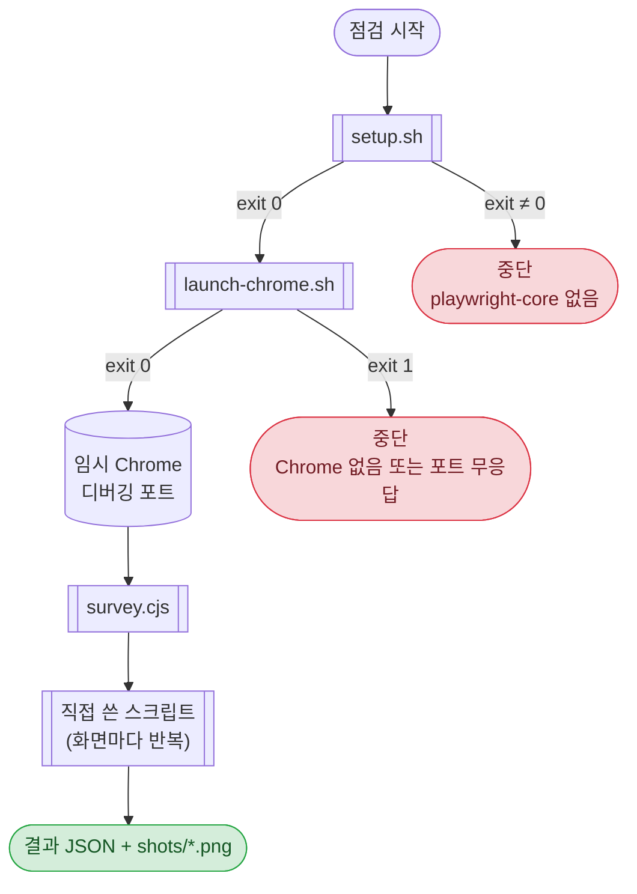
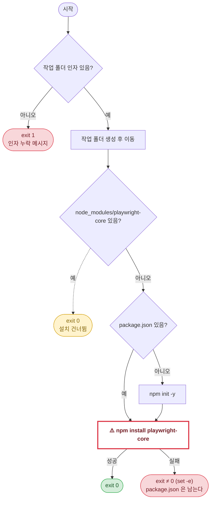
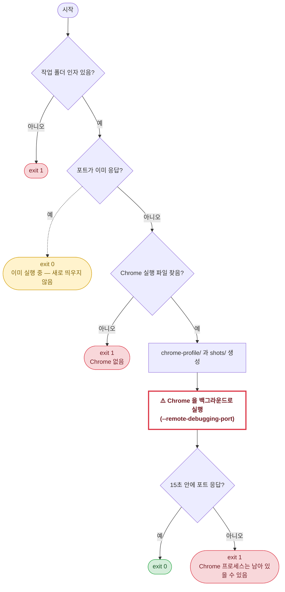
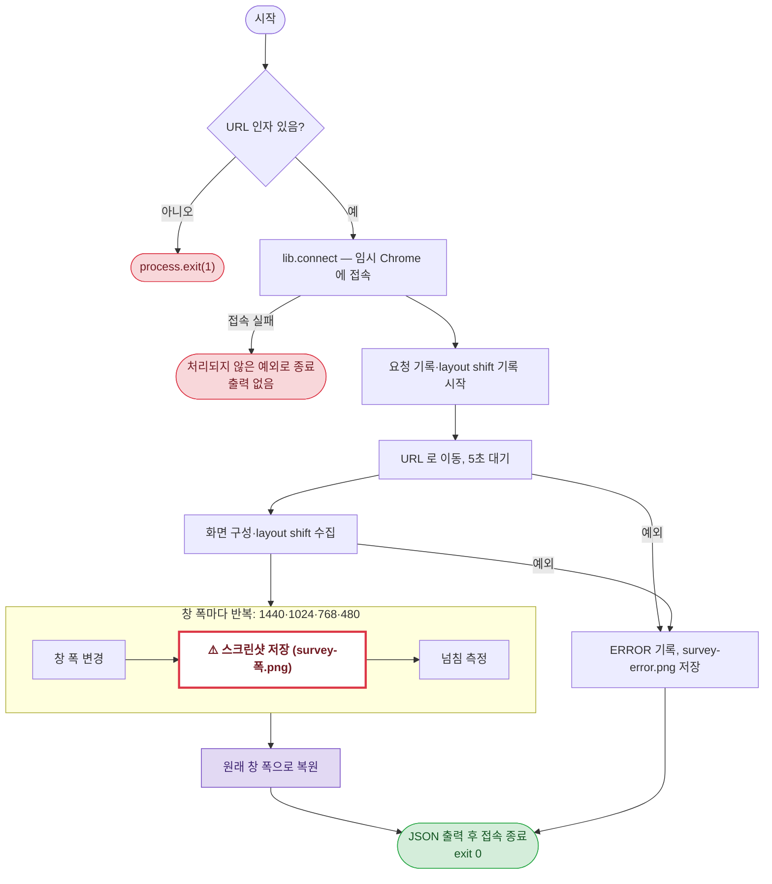
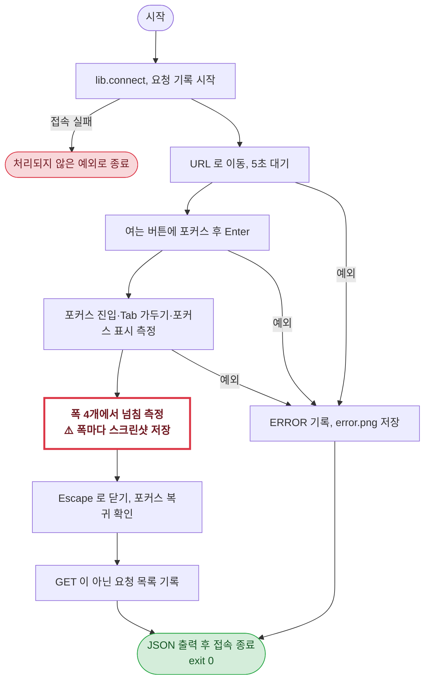

# scripts 실행 흐름

> 실행 방법·순서는 [../setup.md](../setup.md) 참고. 이 문서는 동작 이해용이다.

## 1. 개요

실행 중인 웹 화면을 점검하기 위한 스크립트 모음이다. 작업 폴더에 `playwright-core` 를 설치하고(`setup.sh`),
별도 프로필의 임시 Chrome 을 디버깅 포트로 띄운 뒤(`launch-chrome.sh`), Node 스크립트(`survey.cjs`, `example-dialog.cjs` 복사본 또는 직접 쓴 스크립트)가
그 Chrome 에 접속해 화면을 조작·측정한다. 점검 대상 앱의 파일은 건드리지 않고, 바뀌는 것은 작업 폴더 안뿐이다.

## 2. ⚠️ 주의할 명령

| 위치(파일:줄) | 명령 | 영향 | 등급 | 완화 장치 | 권장 |
|---|---|---|---|---|---|
| `launch-chrome.sh:36` | Chrome 을 `--remote-debugging-port` 로 실행 | 같은 기기의 어떤 프로세스든 이 포트로 브라우저를 조종할 수 있다. 로그인한 세션이 포함된다 | 중간(권한·보안) | 부분 — 별도 프로필이라 평소 브라우저의 세션은 노출되지 않는다. 포트 접근 제한은 없다 | 점검이 끝나면 임시 Chrome 창을 닫는다. 공용 기기에서는 쓰지 않는다 |
| `setup.sh:15` | `npm install playwright-core` | 외부 레지스트리에서 패키지를 내려받아 작업 폴더에 설치한다 | 중간(권한·보안) | 부분 — 이미 설치돼 있으면 건너뛴다. 버전 고정은 없다 | 재현이 필요하면 `playwright-core@<버전>` 으로 고정한다 |
| `lib.cjs` `shot()` | `page.screenshot({ path })` | 같은 이름의 스크린샷 파일을 덮어쓴다 | 중간(덮어쓰기) | 없음 | 이름에 화면과 창 폭을 넣어 겹치지 않게 한다(`survey-<폭>` 처럼) |

삭제·서비스 중단 명령은 없다. Node 스크립트가 화면에서 누르는 버튼이 서버 데이터를 바꿀 수 있는지는 스크립트가 아니라 점검 절차([../safety.md](../safety.md))가 다룬다.

## 3. 폴더 실행 흐름

스크립트끼리 서로 호출하지 않는다. 준비(`setup.sh`, `launch-chrome.sh`) 뒤에 무엇을 실행할지는 점검하는 쪽이 정한다. 아래는 제공된 스크립트를 쓰는 경우다.

| 진입점 | 역할 | 단독 실행 가능 여부 |
|---|---|---|
| `setup.sh <작업 폴더>` | 작업 폴더에 `playwright-core` 설치 | 가능. 네트워크 필요 |
| `launch-chrome.sh <작업 폴더> [포트]` | 임시 Chrome 실행, 디버깅 포트가 열릴 때까지 대기 | 가능. Chrome 설치 필요 |
| `survey.cjs <URL> [루트] [폭 목록]` | 화면 구성 파악 + 폭별 넘침 + layout shift | 위 둘이 끝난 뒤. `BV_WORK` 필요 |
| `example-dialog.cjs` 의 복사본 | 화면별 조작·측정 | 위 둘이 끝난 뒤. `BV_WORK`·`BV_LIB` 필요 |
| `lib.cjs` | 공통 함수 모듈 | 단독 실행하지 않는다 |

Node 스크립트는 측정 중 오류가 나도 종료 코드 0 으로 끝난다. 성공 여부는 종료 코드가 아니라 출력 JSON 의 `ERROR` 키로 판단한다.

## 4. 스크립트별 순서도

### setup.sh

### launch-chrome.sh

### survey.cjs

### example-dialog.cjs

다이얼로그 점검을 스크립트로 쓴 예시다. 따라야 할 절차가 아니며, 아래는 예시 그대로의 흐름이다.

## 5. 부수효과

| 대상 파일/리소스 | 변경 | 백업 | 롤백 |
|---|---|---|---|
| `<작업 폴더>/package.json`, `node_modules/` | `setup.sh` 가 없으면 만들고 `playwright-core` 를 설치 | 없음 | 수동 — 작업 폴더 삭제 |
| `<작업 폴더>/chrome-profile/` | 임시 Chrome 의 프로필(쿠키·로그인 세션 포함) 생성 | 없음 | 수동 — Chrome 종료 후 폴더 삭제 |
| `<작업 폴더>/shots/*.png` | 스크린샷 생성, 같은 이름은 덮어씀 | 없음 | 해당 없음 |
| Chrome 프로세스 | 백그라운드로 실행되어 스크립트가 끝나도 남는다 | — | 수동 — 창을 닫는다 |
| 임시 Chrome 의 창 상태 | 창 폭 변경(끝나면 복원), 열려 있던 페이지 이동 | — | 자동 — `withWidths` 가 원래 폭으로 되돌린다 |
| 점검 대상 페이지 | `addInitScript` 로 layout shift 기록 코드를 심는다. 같은 페이지에서 이후 이동에도 유지된다 | — | 수동 — 탭을 닫거나 새 탭을 쓴다 |

## 6. 관용구 해설

| 줄/표현 | 의미 |
|---|---|
| `WORK="${1:?작업 폴더를 …}"` | 첫 인자가 없거나 비면 메시지를 출력하고 종료한다 |
| `"${CHROME:-}"` | `CHROME` 환경 변수가 없으면 빈 문자열로 둔다(`set -u` 에서 미정의 변수 오류를 피한다). 값이 있으면 후보 목록의 첫 번째가 된다 |
| `"$(command -v google-chrome \|\| true)"` | 명령이 없으면 `command -v` 가 실패하는데, `\|\| true` 로 `set -e` 종료를 막고 빈 문자열을 넘긴다 |
| `if curl -s …/json/version >/dev/null 2>&1; then` | 디버깅 포트가 응답하는지만 본다. `if` 조건 안이라 실패해도 `set -e` 로 종료하지 않는다 |
| `"$CHROME" … about:blank >/dev/null 2>&1 &` | Chrome 을 백그라운드로 띄운다. 스크립트가 끝나도 Chrome 은 계속 실행된다 |
| `for _ in $(seq 1 30); do … sleep 0.5; done` | 0.5초 간격으로 최대 30번(15초) 포트를 확인한다 |
| `[ -f package.json ] \|\| npm init -y` | `package.json` 이 없을 때만 만든다 |
| `require(require.resolve("playwright-core", { paths: [WORK, process.cwd()] }))` | `lib.cjs` 가 있는 플러그인 폴더가 아니라 작업 폴더의 `node_modules` 에서 패키지를 찾는다 |
| `chromium.connectOverCDP(...)` | 브라우저를 새로 띄우지 않고 이미 떠 있는 Chrome 에 접속한다 |
| `await browser.close()` (`finish`) | CDP 로 접속한 경우 브라우저를 종료하지 않고 접속만 끊는다 |
| `page.addInitScript(...)` | 페이지가 새로 로드될 때마다 먼저 실행되는 코드를 등록한다. 이동 전에 호출해야 로딩 중의 layout shift 가 잡힌다 |
| `try { … } catch (e) { out.ERROR = … }` 뒤 `finish` | 중간에 실패해도 그때까지 모은 결과를 출력한다 |

## 7. 주의할 점

- Node 스크립트는 측정 중 오류가 나도 종료 코드가 0 이다. 종료 코드로 성공을 판단하면 실패를 놓친다 → 출력 JSON 의 `ERROR` 키를 본다.
- `lib.connect` 가 실패하면(Chrome 이 떠 있지 않음) `try` 밖이라 처리되지 않은 예외로 끝나고 JSON 이 출력되지 않는다 → `launch-chrome.sh` 를 먼저 실행한다.
- 포트를 기본값이 아닌 값으로 띄웠는데 Node 스크립트에 `BV_PORT` 를 주지 않으면 9333 으로 접속을 시도해 실패한다.
- `launch-chrome.sh` 가 15초 대기 뒤 `exit 1` 로 끝나도 Chrome 프로세스는 남아 있을 수 있다. 다시 실행하면 같은 프로필로 두 번째 Chrome 을 띄우려다 실패할 수 있다 → 남은 창을 닫고 다시 실행한다.
- `startLayoutShiftWatch` 를 같은 페이지에서 여러 번 호출하면 기록 코드가 여러 번 등록된다. 기록 배열은 로드마다 새로 만들어지므로 값이 중복되지는 않지만, 스크립트마다 한 번만 호출한다.
- `overflowReport` 는 부모가 `overflow: hidden|auto|scroll|clip` 이면 "부모 밖으로 나간 요소"로 세지 않는다. 잘려서 안 보이는 경우는 `clipped`(글자)만 잡으므로, 잘린 버튼·아이콘은 스크린샷으로 확인한다.
- `composingEnter` 는 합성 이벤트다. 실제 입력기의 조합 동작과 같다고 보지 않는다.
- ShellCheck 미실행(설치돼 있지 않음). `bash -n` 과 `node --check` 는 모든 파일에서 통과했다.
