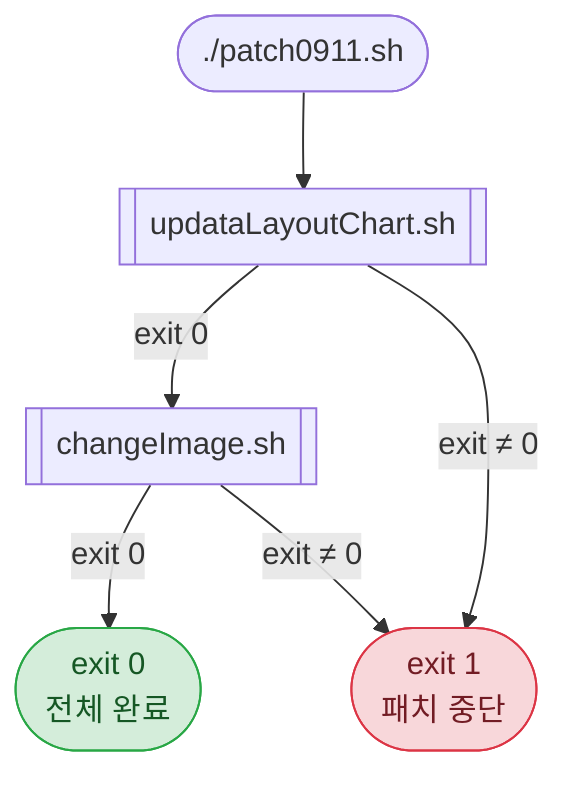
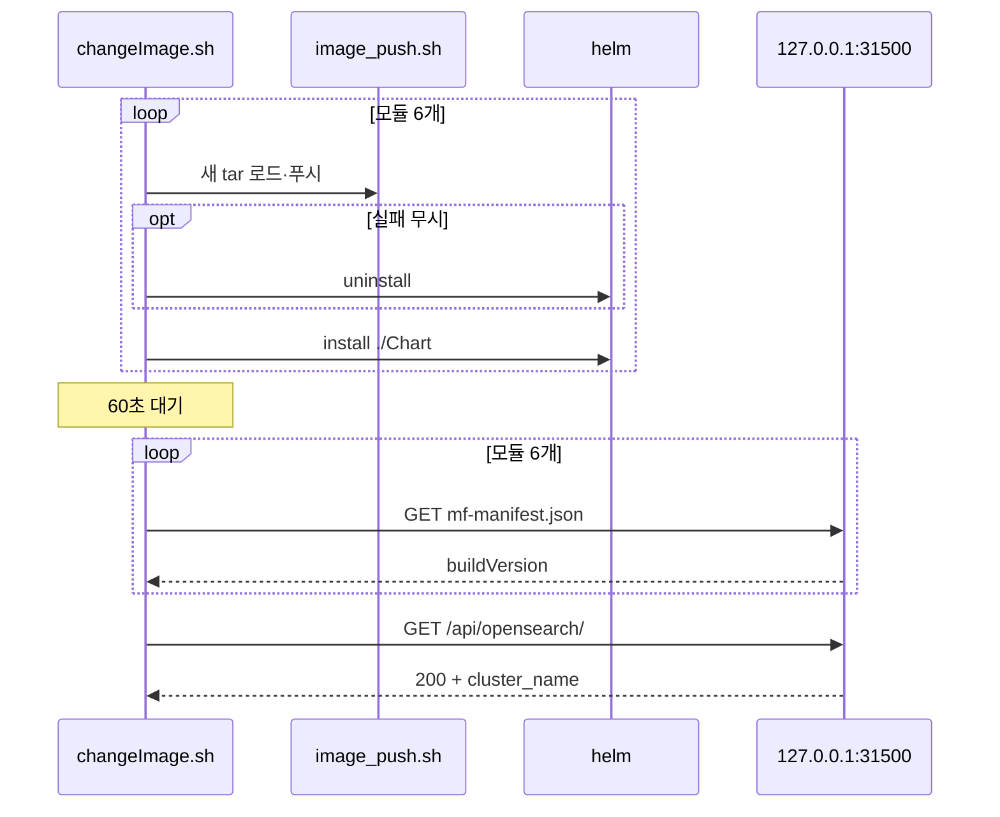
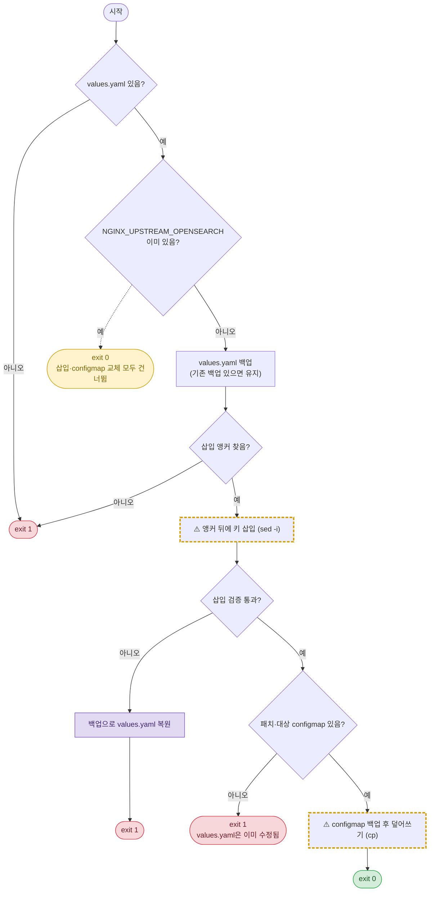

# FLOW.md 섹션 형식

폴더마다 `FLOW.md` 하나를 두고 아래 7개 섹션을 이 순서로 쓴다. 해당 내용이 없는 섹션은
"해당 없음" 한 줄로 남긴다(지우면 누락인지 의도인지 구분할 수 없다).
예시는 운영 패치 폴더 `web-patch0911`(오케스트레이터 `patch0911.sh`가 `updataLayoutChart.sh` →
`changeImage.sh`를 순서대로 실행) 기준이다. 다이어그램 문법·색 규약은 `mermaid-rules.md`를 따른다.

## 목차

1. 개요
2. ⚠️ 주의할 명령
3. 폴더 실행 흐름
4. 스크립트별 순서도
5. 부수효과 표
6. 관용구 해설 표
7. 주의할 점
8. 언어 확장

## 템플릿

````markdown
# <폴더 이름> 실행 흐름

> 실행 방법·환경은 [README.md](README.md) 참고. 이 문서는 동작 이해용이다.

## 1. 개요
## 2. ⚠️ 주의할 명령
## 3. 폴더 실행 흐름
## 4. 스크립트별 순서도
### <스크립트 이름>
## 5. 부수효과
## 6. 관용구 해설
## 7. 주의할 점
````

## 1. 개요

한두 줄. 이 폴더가 **무엇을 어디에** 바꾸는지와 진입점을 쓴다.

> `patch0911.sh` 하나로 실행한다. layout 차트에 OpenSearch 프록시 설정을 넣은 뒤,
> 6개 UI 모듈의 이미지를 교체하고 helm으로 재배포·검증한다.

## 2. ⚠️ 주의할 명령

개요 바로 뒤에 둔다. 읽는 사람이 실행 전에 위험부터 보게 하기 위해서다. 분류·등급·완화 장치 판정은
`risky-commands.md`를 따른다. 해당 명령이 없으면 "해당 없음".

| 위치(파일:줄) | 명령 | 영향 | 등급 | 완화 장치 | 권장 |
|---|---|---|---|---|---|
| `changeImage.sh:55` | `rm -f "$OLD_TAR"` (glob, 루프 안) | 대상 서버의 기존 이미지 tar 삭제 | 높음 | 부분 — `[ -e ]` 검사만, 백업 없음 | 삭제 대신 `mv "$OLD_TAR" "$OLD_TAR.prev"` |
| `changeImage.sh:68` | `sed -i` image.tag 교체 | 모듈별 `values.yaml` 제자리 수정 | 높음(루프 안·백업 없음) | 없음 — 교체 확인만 | 수정 직전 `cp "$VALUES" "$VALUES.bak.0911.txt"` |
| `changeImage.sh:79` | `helm uninstall` → `helm install` | 모듈마다 재배포 사이 서비스 중단, install 실패 시 미설치 상태로 종료 | 높음 | 없음 | `helm upgrade --install` 검토 |
| `updataLayoutChart.sh:67` | `sed -i` 앵커 뒤 삽입 | layout `values.yaml` 수정 | 중간 | 있음 — 백업 + 검증 실패 시 복원 | — |
| `updataLayoutChart.sh:106` | `cp "$SRC_CONFIGMAP" "$DEST_CONFIGMAP"` | configmap 덮어쓰기 | 중간 | 있음 — 백업(자동 복원은 없음) | — |

- 줄 번호는 스크립트를 고칠 때마다 다시 확인한다. 명령 칸에는 코드 표현을 함께 적어 줄이 어긋나도 찾을 수 있게 한다.
- 완화 장치가 "없음" 또는 "부분"이면 권장 칸을 비우지 않는다.
- 같은 명령은 순서도에서 `danger`(완화 없음·부분)·`guarded`(완화 있음) 클래스로 표시한다.

## 3. 폴더 실행 흐름

오케스트레이터 → 하위 스크립트 호출 순서와, 상위가 하위의 종료 코드를 어떻게 해석하는지 그린다.
진입점이 여럿이고 서로 호출하지 않으면 다이어그램 대신 "진입점 | 역할 | 단독 실행 가능 여부" 표로 쓴다.

| 상황 | 다이어그램 |
|---|---|
| 스크립트 간 순서·분기·중단 조건이 핵심 | `flowchart` (기본) |
| 외부 시스템(helm, kubectl, curl, 레지스트리, DB) 요청·응답·검증 순서가 핵심 | `sequenceDiagram` |
| 둘 다 중요 | `flowchart`로 순서를 그리고, 외부 호출이 많은 스크립트 하나에만 `sequenceDiagram` 추가 |



다이어그램 아래에 상위가 **구분하지 못하는** 결과를 적는다. 예: `updataLayoutChart.sh`가 키가 이미 있어
configmap 교체를 건너뛰어도 `exit 0`이므로 오케스트레이터는 "완료"로 보고 다음 단계로 간다.

외부 호출 순서가 중요한 스크립트는 sequenceDiagram을 덧붙인다.



## 4. 스크립트별 순서도

스크립트마다 `###` 소제목과 flowchart 하나. 반드시 드러낼 것:

- **모든 종료 지점** — 명시 `exit`/`sys.exit`/`process.exit`, 처리되지 않은 예외,
  `set -e` 같은 암묵 종료. `fail` 또는 `ok` 클래스.
- **건너뛰는 분기** — 성공 코드로 끝나지만 이후 단계를 하지 않는 경로. `skip` 클래스, 점선 간선.
- **실패 복원 경로** — 백업 복원·정리 단계. `restore` 클래스.
- **주의할 명령** — 2절 표의 명령을 담은 노드. 라벨 앞에 `⚠️`, 완화 장치 유무에 따라 `guarded`/`danger` 클래스.
- 복원 없이 끝나는 실패에서 **이미 바뀐 상태**를 종료 노드 라벨에 적는다.

예: `updataLayoutChart.sh`. 키가 이미 있으면 `exit 0`으로 스크립트 전체를 끝내므로
뒤쪽 configmap 교체까지 건너뛴다.



반복문이 있는 스크립트(`changeImage.sh`의 모듈 루프)는 본문을 `subgraph`로 감싼다.
루프 안의 실패가 루프 전체를 끝내는지(`exit`), 다음 반복으로 넘어가는지(`continue`), 실패를 모아
루프 뒤에 판정하는지(`VERIFY_FAIL=1`)를 간선으로 구분한다.

## 5. 부수효과 표

스크립트가 바꾸는 파일·리소스를 모두 적는다. 읽기만 하는 대상은 넣지 않는다.

| 대상 파일/리소스 | 변경 | 백업 | 롤백 |
|---|---|---|---|
| `layout/Chart/values.yaml` | `NGINX_UPSTREAM_OPENSEARCH` 줄 삽입 | `values.yaml.bak.0911.txt` (이미 있으면 유지) | 삽입 검증 실패 시 자동 복원, 그 외 수동 `cp` |
| `layout/Chart/templates/configmap.yaml` | 패치 파일로 덮어씀 | `configmap.yaml.bak.0911.txt` | 수동 `cp` |
| 모듈별 `ui-<module>_*.tar` | 기존 tar 삭제 후 새 tar 복사 | 없음 | 이전 tar 재배치 후 재실행 |
| 모듈별 `Chart/values.yaml`의 `image.tag` | 새 버전으로 교체 | 없음 | 수동 수정 후 재배포 |
| helm 릴리스 `ui-<module>-module` | uninstall → install (그 사이 중단) | 없음 | 이전 tag로 재배포 |
| `/tmp/opensearch_check.json` | 임시 생성 후 삭제 | — | — |

- "백업" 열은 스크립트가 **자동으로** 만드는 것만 적는다.
- "롤백" 열은 자동인지 수동인지 먼저 쓴다. 상세 명령은 README에 있으면 링크만 건다.
- 경로는 스크립트 변수 기준 상대 표기(`$TARGET_BASE` 아래 등)로 쓴다.

## 6. 관용구 해설 표

문법만으로 의미를 짐작하기 어려운 표현을 고른다. 언어별 후보는 `idioms/<언어>.md`에 있다.
"줄/표현" 열에는 줄 번호 대신 코드 표현을 인용하고, 필요하면 스크립트 이름을 앞에 붙인다.

| 줄/표현 | 의미 |
|---|---|
| `MODULE="${ENTRY%%:*}"` | `"auth:ai_central_auth"`에서 첫 `:` 앞 `auth`만 남긴다. `:`가 없으면 원문 그대로 |
| `PREFIX="${ENTRY##*:}"` | 마지막 `:` 뒤 `ai_central_auth`만 남긴다. `:`가 없으면 원문 그대로라 다음 줄에서 `MODULE`로 대체 |
| `[ -e "$OLD_TAR" ] \|\| continue` | glob이 아무 파일과도 맞지 않으면 패턴 문자열 자체가 들어오므로 건너뛴다 |
| `helm uninstall ... \|\| echo ...` | uninstall 실패를 무시하고 install로 진행한다(`set -e`로 종료되지 않음) |
| `sed -i "${ANCHOR_LINE}a\\` + 개행 + `${INSERT_LINE}"` | 앵커 줄 **뒤에** 한 줄 삽입. GNU sed 전용 형태 |

표 안의 `|`는 `\|`로 이스케이프한다.

## 7. 주의할 점

위험 명령 목록은 2절에 두고, 여기에는 순서도를 그리며 드러난 숨은 동작, 코드와 주석·README의 불일치, 정적 분석 경고를 적는다.
각 항목은 "무엇이 일어나는가 → 언제 문제가 되는가 → (있으면) 대응" 순서로 한두 줄.

- `updataLayoutChart.sh`가 configmap 단계에서 실패한 뒤 다시 실행하면, 키가 이미 있어 `exit 0`으로
  끝나므로 configmap은 끝내 교체되지 않는다. 재실행 전 configmap을 수동 확인한다.
- `updataLayoutChart.sh`에 shebang이 없다. 오케스트레이터는 `bash`로 호출하므로 문제없지만,
  README의 `./updataLayoutChart.sh` 단독 실행은 호출한 셸에 따라 해석기가 달라진다.
- `changeImage.sh` 첫 주석은 "0904 패치: agent, assistant"로 실제 대상 모듈과 다르다.
- 버전 검증은 6개 모듈을 모두 재배포한 **뒤에** 수행되며, 실패해도 롤백하지 않는다.
- 정적 분석(ShellCheck 등) 경고는 규칙 번호와 함께 요약한다. 도구를 실행하지 못했으면 그 사실을 적는다.

## 8. 언어 확장

언어별 관용구는 `idioms/` 디렉터리에 언어마다 파일 하나로 둔다. 새 언어는 `idioms/<언어>.md`
하나를 추가하면 되고, 이 형식 문서와 스킬 본문은 고치지 않는다. 새 파일은 기존 파일과 같은 구성
(적용 대상 → 흐름을 오해하기 쉬운 관용구 표 → 그 언어 특유의 위험 패턴 → 순서도 반영 방식 → 정적 점검)을 따른다.
